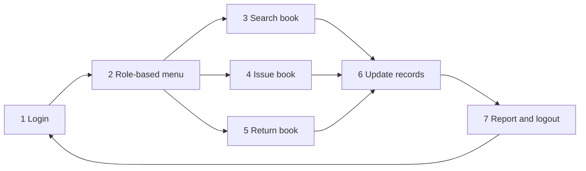
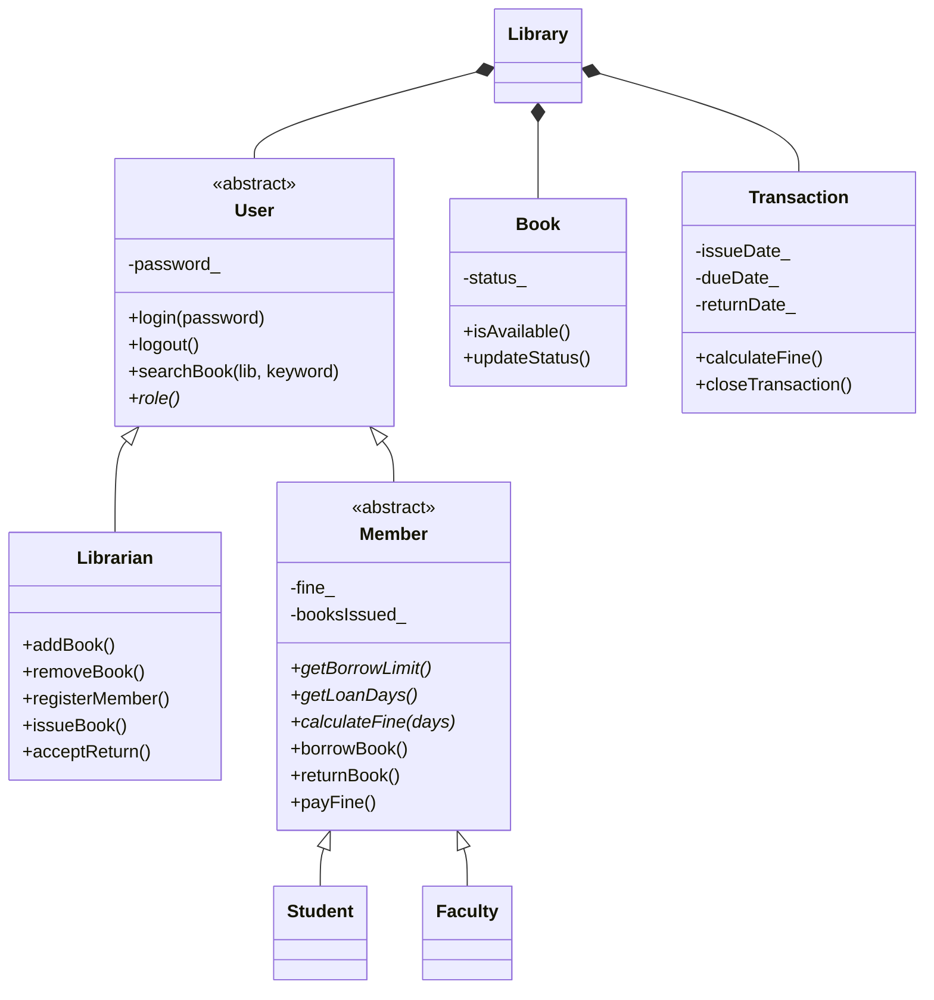

# Library-Management-System-


A console-based Library Management System written in modern C++ (C++17) to demonstrate Object-Oriented Programming. It lets a librarian manage books and members, issue and return books, calculate fines, and generate reports, while members can search the catalogue, renew loans and pay fines. All data is saved to plain text files, so nothing is lost between runs.


The code follows a seven-step workflow (login, role-based menu, search, issue, return, update records, report and logout), and **each step lives in its own source file**, so it is easy to read, explain and extend.

---

## Table of contents

- [Features](#features)
- [Quick start](#quick-start)
- [How to use it](#how-to-use-it)
- [Sample output](#sample-output)
- [Workflow and project structure](#workflow-and-project-structure)
- [Design](#design)
- [Data files](#data-files)
- [Testing](#testing)
- [Limitations and future work](#limitations-and-future-work)
- [Contributing and license](#contributing-and-license)

---

## Features

**Librarian**
- Add and remove books (a book that is currently issued cannot be removed)
- Register students and faculty members (IDs such as `S001` and `F001` are generated automatically)
- Issue books with a due date and a printed receipt
- Accept returns, calculate overdue fines and print a receipt
- Search the catalogue, view all books, view active loans
- Generate a library report with the overdue list

**Member (Student or Faculty)**
- Search the catalogue by title, author, ISBN or category
- View their own issued books
- Renew a loan (once, and only if it is not overdue)
- Pay fines

**System**
- Role-based access: only a `Librarian` object has the management methods
- Different rules per member type, chosen by polymorphism (see below)
- Data saved after every change; damaged records are skipped with a warning
- Safe input handling: bad numbers, bad dates and closed input never crash the program

### Member types

| Member type | Books at a time | Loan period | Fine per late day |
|-------------|-----------------|-------------|-------------------|
| Student     | 3               | 14 days     | 2.00              |
| Faculty     | 5               | 30 days     | 1.00              |

Business rules: an issued book cannot be issued again until it is returned, a member with an unpaid fine cannot borrow until it is paid, and the same loan cannot be returned twice.

---

## Quick start

**Requirements:** a C++17 compiler (g++ 8 or newer, or clang). No external libraries.

```bash
git clone https://github.com/<your-username>/library-management-system.git
cd library-management-system
make
./lms
```

If you do not have `make`, compile directly:

```bash
# Linux and macOS
g++ -std=c++17 -Wall -Wextra *.cpp -o lms
./lms
```

```bat
:: Windows (MinGW-w64 or MSYS2, g++ on PATH)
g++ -std=c++17 -Wall -Wextra main.cpp step1_login.cpp step2_menu.cpp step3_search.cpp step4_issue.cpp step5_return.cpp step6_records.cpp step7_report_logout.cpp -o lms.exe
lms.exe
```

> On macOS, run `xcode-select --install` once to get the compiler.

The program creates its data files (`books.txt`, `users.txt`, `transactions.txt`) in the current directory, so run it from the same folder each time.

### First login

On the first run a default librarian account is created:

| User ID | Password   |
|---------|------------|
| `L001`  | `admin123` |

---

## How to use it

1. Log in as the librarian (`L001` / `admin123`).
2. **Register a member** (menu 3), for example a Student. Note the generated ID, such as `S001`.
3. **Add a book** (menu 1).
4. **Issue the book** (menu 4) using the member ID and book ID. Press Enter to use today's date.
5. **Accept the return** (menu 5). Press Enter to use today's date.
6. **Generate a report** (menu 9), then log out (menu 0). Enter `0` as the User ID to exit the program.

Members log in with their own ID and the password the librarian set for them.

**Trying out fines without waiting two weeks:** when issuing, type a past issue date (format `YYYY-MM-DD`), for example 20 days ago. Returning it today will then show an overdue fine. Future dates are rejected.

### Menus

```
===== LIBRARIAN MENU =====          ===== MEMBER MENU =====
 1. Add book                         1. Search book
 2. Remove book                      2. View my issued books
 3. Register member                  3. Renew a book
 4. Issue book                       4. Pay fine
 5. Accept return                    0. Logout
 6. Search book
 7. View all books
 8. View active loans
 9. Generate report
 0. Logout
```

---

## Sample output

Real output from the program:

```
------------- ISSUE RECEIPT -------------
  Transaction : #1
  Book        : [1] Introduction to Algorithms
  Member      : S001 - Asha Rao (Student)
  Issued on   : 2026-10-25
  Due date    : 2026-11-08
  Books held  : 1 of 3
-----------------------------------------
```

```
------------ RETURN RECEIPT -------------
  Transaction : #4
  Book        : [5] The Pragmatic Programmer
  Member      : F001 - Dr. Meera Iyer (Faculty)
  Due date    : 2026-10-15
  Returned on : 2026-10-25
  Overdue     : 10 day(s)
  Fine        : 10.00
-----------------------------------------
```

```
=========== LIBRARY REPORT (2026-10-25) ===========
  Book titles        : 5
  Available / Issued : 2 / 3
  Members            : 1 student(s), 1 faculty
  Active loans       : 3
  Overdue loans      : 1
  Unpaid member fines: 6.00
  Fines charged total: 10.00

  Overdue list:
   Txn #5  Clean Code  member S001  due 2026-10-19  (6 days late)
```

---

## Workflow and project structure

The program follows seven workflow steps. Each step has its own file.



| Step | File | What it contains |
|------|------|------------------|
| 1 Login | `step1_login.cpp` | Login screen (3 attempts), `User::login`, `Library::authenticate` |
| 2 Role-based menu | `step2_menu.cpp` | Librarian and member menus, add/remove book, register member |
| 3 Search book | `step3_search.cpp` | `Library::search`, results table |
| 4 Issue book | `step4_issue.cpp` | Issue checks, `Transaction` creation, issue receipt, loan tables |
| 5 Return book | `step5_return.cpp` | Return, fine calculation, renew, pay fine |
| 6 Update records | `step6_records.cpp` | `save`, `load`, damaged-line handling |
| 7 Report and logout | `step7_report_logout.cpp` | `generateReport`, logout |
| Entry point | `main.cpp` | Program loop: login, menu, logout |

```
.
├── main.cpp                   program loop
├── step1_login.cpp            step 1
├── step2_menu.cpp             step 2
├── step3_search.cpp           step 3
├── step4_issue.cpp            step 4
├── step5_return.cpp           step 5
├── step6_records.cpp          step 6
├── step7_report_logout.cpp    step 7
├── app.h                      LibraryApp (console user interface)
├── library.h                  Library (books, users, transactions)
├── user.h                     User, Librarian, Member, Student, Faculty
├── book.h                     Book
├── transaction.h              Transaction (one loan)
├── date.h                     Date (day count, leap years)
├── console.h                  safe console input
├── util.h                     error types and text helpers
├── Makefile
└── README.md
```

The `Library` and `LibraryApp` classes are declared once (`library.h`, `app.h`), and their methods are defined in the file of the step they belong to.

---

## Design

### Class diagram



A **loan** is one member borrowing one book. In the code it is a `Transaction`: it is open (active) from the moment the book is issued until it is returned, then it is closed and kept as history.

### OOP concepts used

| Concept | Where |
|---------|-------|
| Encapsulation | `User::password_` is private and checked only through `login()`; book status changes only through `updateStatus()` |
| Abstraction | `User` and `Member` are abstract; the UI calls `issueBook()` without knowing how loans are stored |
| Inheritance | `Librarian` and `Member` from `User`; `Student` and `Faculty` from `Member` |
| Polymorphism | `getBorrowLimit()`, `getLoanDays()` and `calculateFine()` are virtual and overridden, so issue and return code never checks the member type |
| Composition | `Library` owns the books, users (`unique_ptr<User>`) and transactions |
| Role-based access | Only `Librarian` has `issueBook()` and `acceptReturn()`; the menu is chosen with `dynamic_cast` on the real object type |
| Operator overloading | `operator<<` prints a `Book` as a table row; `Date` overloads `+`, `-` and comparisons |
| RAII and smart pointers | `std::unique_ptr` for users; no manual `new` or `delete` |
| Exceptions | `LibraryError` for rule violations, caught per operation so the menu keeps running |

### Adding a new member type

Create a class derived from `Member`, override `getBorrowLimit()`, `getLoanDays()`, `calculateFine()`, `role()` and `typeCode()`, and add its type code to the loader in `step6_records.cpp`. The issue and return code does not change.

---

## Data files

Records are plain text, one per line, with fields separated by `|`.

| File | Fields |
|------|--------|
| `books.txt` | `id \| title \| author \| isbn \| category \| status` (0 = available, 1 = issued) |
| `users.txt` | `type \| id \| name \| email \| password \| fine` (type: `L` librarian, `S` student, `F` faculty) |
| `transactions.txt` | `id \| bookId \| memberId \| issueDate \| dueDate \| closed \| returnDate \| fine \| renewals` |

- Data is saved after every change and when you log out or exit.
- A missing file simply means a first run.
- A damaged line is skipped with a warning (file name and line number) and the rest loads. Note that skipped lines are removed from the file the next time it is saved, so copy the file first if you want to repair it by hand.
- After loading, each book's status and each member's list of held books are rebuilt from the open transactions, so the files cannot contradict themselves.
- The `|` character is replaced with `/` in typed text so it cannot break a record.

---

## Testing

There is no unit-test framework. The program was tested by running scripted console sessions and checking the output. Scenarios covered:

- Wrong password three times (login blocked)
- Student limit: the 4th book is refused and nothing changes
- Issuing a book that is already issued, an unknown book, an unknown member
- Overdue return: Student 6 days late = 12.00, Faculty 10 days late = 10.00
- Returning the same loan twice (refused)
- A member with an unpaid fine cannot borrow until it is paid
- Renewing once, and refusing a second renewal or a renewal when overdue
- Leap-day dates (`2024-02-29` accepted, `2023-02-29` rejected)
- Data surviving a restart
- A damaged line in a data file (skipped with a warning)
- Closed input (Ctrl+D / Ctrl+Z) saves and exits cleanly


## Limitations and future work

**Current limitations**
- Passwords are stored as plain text (fine for a demo, not for production)
- Each book is a single copy; there are no multiple copies per title
- Search scans every book (linear time)
- Single user; the data files are rewritten in full on every save

**Ideas for the future**
- Hash passwords with a salt
- Several copies per title
- Replace the text files with a database such as SQLite
- Reservations and a waiting list, e-books, barcode scanning
- Automated unit tests


